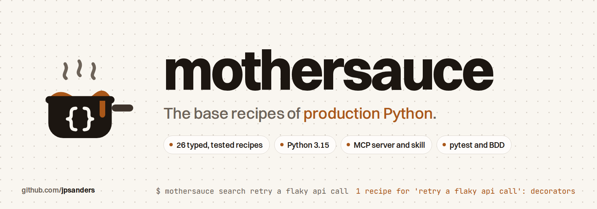

<p align="center">
  <picture>
    <source media="(prefers-color-scheme: dark)" srcset="docs/images/banner-dark.png">
    
  </picture>
</p>

<p align="center">
  <a href="https://github.com/jpsanders/mothersauce/actions/workflows/dev.yml"></a>
  <a href="https://github.com/jpsanders/mothersauce/releases/latest"></a>
  <a href="https://www.python.org/downloads/"></a>
  <a href="#the-menu"></a>
  <a href="#for-ai-agents"></a>
  <a href="#for-ai-agents"></a>
  <a href="skills/mothersauce/SKILL.md"></a>
  <a href="https://mypy-lang.org/"></a>
  <a href="https://github.com/psf/black"></a>
  <a href="tests/features"></a>
  <a href="pyproject.toml"></a>
  <a href="pyproject.toml"></a>
  <a href="LICENSE"></a>
  <a href="https://github.com/jpsanders/mothersauce/commits/main"></a>
  <a href="https://github.com/jpsanders/mothersauce/stargazers"></a>
</p>

Every cuisine rests on a handful of mother sauces. Learn them and every other sauce is a variation. Production Python
is the same: a few dozen patterns carry almost every codebase, from the dataclass that holds a value to the context
manager that commits a transaction.

mothersauce is those patterns as 26 recipes. Each code recipe is one small module of Python 3.15 with full type
hints, Sphinx docstrings, a demo you can run and its own tests, plus a card that says when to use it and when not to.
You read them on the command line or in a man page; your AI agent reads the same recipes over MCP or through a skill.

```sh
uv tool install git+https://github.com/jpsanders/mothersauce
mothersauce search "retry a flaky api call"
mothersauce show decorators
mothersauce run pipeline
```

```text
$ mothersauce run pipeline
The pipeline: Every recipe plated together: a small, real ETL with quality rules, upserts, watermarks and JSON logs.

run-1: read 16, loaded 12, skipped 0, quarantined 3, invalid 1 in 98 ms
run-2: read 16, loaded 0, skipped 12, quarantined 3, invalid 1 in 0 ms
findings on the first run: {'large_quantity': 1, 'known_station': 1, 'quantity_positive': 1, 'unique_key': 1}
invalid: ['RecordError: line 16, opened_at: input should have timezone info']
dishes by station: {'cold': 25, 'sauce': 12, 'grill': 6, 'pastry': 4, 'fry': 2}
the next run starts after 20:05, line T-1010-1
4 JSON log lines, each carrying its run id
```

## Why

Most of what makes Python production grade is never in the tutorial. Parse untrusted input once, at the edge. Freeze
values. Pair every acquire with its release. Stream instead of loading. Keep the cause when you raise. Log JSON with a
run id. These are learned on the job, one incident at a time, and an AI agent that learned Python from the internet
writes code that runs but is rarely shaped like this.

Each recipe holds one pattern in one module, written the way it would be in a production codebase: typed for mypy's
strict mode, documented, tested, and short enough to read in one sitting. The recipes share one example domain, a
restaurant's ticket feed, so they read as one system, and the last of them, the pipeline, loads that feed using all
the others.

## The menu

<!-- menu:start -->
| Section | Recipe | What it gives you |
| --- | --- | --- |
| Mise en place | [`workflow`](src/mothersauce/data/practice/workflow.md) | pyenv and pyenv-virtualenv, make targets, and CI that runs exactly what your machine runs. |
| Mise en place | [`layout`](src/mothersauce/data/practice/layout.md) | The src layout: one package, one concept per module, tests that mirror it, data shipped inside. |
| Mise en place | [`style`](src/mothersauce/data/practice/style.md) | Nine checks that end style arguments: black, isort, flake8, darglint, mypy strict, bandit and more. |
| Mother sauces | [`dataclasses`](src/mothersauce/recipes/value_objects.py) | Small, honest value objects: frozen, slotted, validated, replaced rather than mutated. |
| Mother sauces | [`pydantic`](src/mothersauce/recipes/models.py) | Parse, don't validate, at the edges: strict models, reusable constraints, discriminated unions. |
| Mother sauces | [`enums`](src/mothersauce/recipes/enums.py) | Closed sets of names: StrEnum, IntEnum, Flag, a state machine, and exhaustive match with assert_never. |
| Mother sauces | [`abstractions`](src/mothersauce/recipes/abstractions.py) | ABCs for families you own, with a template method; Protocols for shapes you accept. |
| Mother sauces | [`factories`](src/mothersauce/recipes/factories.py) | Decide which class to build in one place: registries, __init_subclass__, from_ constructors, plugins. |
| Mother sauces | [`generics`](src/mothersauce/recipes/generics.py) | Write the container once and keep every type: PEP 695 syntax, bounds, defaults, ParamSpec, Result. |
| Mother sauces | [`generators`](src/mothersauce/recipes/generators.py) | Any size of input in the memory of one record: streams, stages, batches, windows, send, cursors. |
| Mother sauces | [`context-managers`](src/mothersauce/recipes/context_managers.py) | Every acquire paired with its release: timers, atomic writes, nested transactions, ExitStack. |
| Mother sauces | [`decorators`](src/mothersauce/recipes/decorators.py) | Cross cutting behaviour written once: typed retry with backoff and jitter, caches, singledispatch. |
| Mother sauces | [`oop`](src/mothersauce/recipes/oop.py) | Composition over inheritance, dunder protocols, properties, descriptors and __slots__. |
| Mother sauces | [`data-structures`](src/mothersauce/recipes/data_structures.py) | The container that makes the code obvious: Counter, deque, heapq, bisect, ChainMap, graphlib. |
| Mother sauces | [`errors`](src/mothersauce/recipes/errors.py) | A hierarchy you can catch, chains you can follow, and batches that report every failure at once. |
| On the line | [`sql`](src/mothersauce/recipes/sql.py) | Injection proof queries with t-strings, schema evolution, idempotent upserts and high watermarks. |
| On the line | [`data-quality`](src/mothersauce/recipes/quality.py) | Rules as data, severities, quarantine, and overrides with an audit trail. |
| On the line | [`pipeline`](src/mothersauce/recipes/pipeline.py) | Every recipe plated together: a small, real ETL with quality rules, upserts, watermarks and JSON logs. |
| Service | [`logging`](src/mothersauce/recipes/logs.py) | JSON lines with a run id from a ContextVar, secrets redacted, configured once with dictConfig. |
| Service | [`config`](src/mothersauce/recipes/config.py) | One frozen settings object from defaults, TOML, environment and flags, with where each value came from. |
| Service | [`concurrency`](src/mothersauce/recipes/concurrency.py) | Wait for many slow things at once, bounded, in order, without losing a single error. |
| Service | [`performance`](src/mothersauce/recipes/performance.py) | Measure first, then make the common path cheap: lazy imports, timeit, import costs. |
| Service | [`cli`](src/mothersauce/cli.py) | This package's own CLI: subcommands, --json on everything, real exit codes, a man page, lazy imports. |
| Service | [`mcp-server`](src/mothersauce/mcp.py) | This package's own MCP server: JSON-RPC over stdio with tools, resources and prompts. |
| The pass | [`testing`](src/mothersauce/data/practice/testing.md) | Fixtures, parametrize, fakes over mocks, doctests and a coverage gate: nothing broken leaves the pass. |
| The pass | [`bdd`](src/mothersauce/data/practice/bdd.md) | Gherkin features run by pytest-bdd: behaviour written so a person can read it and pytest can run it. |
<!-- menu:end -->

The full cards, with when to use each recipe and when not to, are in [docs/RECIPES.md](docs/RECIPES.md).

## Use it

```sh
mothersauce                              # the menu
mothersauce search stream a huge csv     # which recipe for a problem
mothersauce show generators              # the card, the notes and the full tested source
mothersauce show generators --notes      # the card and the notes only
mothersauce run generators               # its demo
mothersauce style                        # the house style
mothersauce guide                        # the whole manual; or: mothersauce man --install && man mothersauce
```

Every command that prints data takes `--json`. Install it with uv or pipx, or straight from a release:

```sh
uv tool install git+https://github.com/jpsanders/mothersauce          # uv fetches Python 3.15 if you lack it
pipx install git+https://github.com/jpsanders/mothersauce
pip install https://github.com/jpsanders/mothersauce/releases/download/1.0.0/mothersauce-1.0.0-py3-none-any.whl
```

## For AI agents

**Claude Code plugin:** the skill and the MCP server in one step.

```text
/plugin install mothersauce --marketplace jpsanders/mothersauce
```

On Claude Code before 2.1.275, add the marketplace first, `/plugin marketplace add jpsanders/mothersauce`, then
`/plugin install mothersauce@mothersauce`.

**Every other harness:** `mothersauce integrate` registers the server and installs the skill in Claude Code, Codex,
OpenCode, Gemini CLI and Cursor, using each harness's own command line where it has one. `--dry-run` shows what it
would change. Or add the server to any MCP client by hand, with nothing installed first:

```json
{"mcpServers": {"mothersauce": {"command": "uvx", "args": ["--from", "git+https://github.com/jpsanders/mothersauce", "mothersauce", "mcp"]}}}
```

| Tool | What it returns |
| --- | --- |
| `search_recipes` | The recipes for a problem described in a few words, best first |
| `get_recipe` | One recipe as Markdown: when to use it, when not, and its complete, tested source |
| `list_recipes` | Every recipe's card, optionally one section or kind |
| `get_style_guide` | The house style: layout, naming, typing, docstrings, errors, logging, tests |

Every tool is read only. The server also offers each recipe as a resource, `mothersauce://recipes/<id>`, and two
prompts, `apply_recipe` and `review_python`. It is one module of the standard library: the `mcp-server` recipe is its
own source.

**Without a server:** `mothersauce skill` prints the skill, and `npx skills add jpsanders/mothersauce` installs it in
the harnesses that tool knows. `mothersauce style --agents` prints a short block for a project's AGENTS.md or
CLAUDE.md that tells any agent to write Python this way. [llms.txt](llms.txt) maps the repository for agents that read
it directly.

## Python 3.15, used for real

The recipes use the newest Python where it makes production code better, not to show off:

| Feature | Version | Where |
| --- | --- | --- |
| `lazy import` | 3.15 | `cli`: the command starts without loading pydantic; `performance` measures it |
| `frozendict` | 3.15 | `enums` for a transition table, `data-structures` for a menu, `factories` for options |
| `sentinel()` | 3.15 | `config`: `int \| UNSET` for a flag left out, narrowed by mypy; `concurrency`: a stop marker |
| Unpacking in comprehensions | 3.15 | `generators`: `(*group for group in groups)` |
| `TypedDict(closed=True)` | 3.15 | `data-structures`: a JSON shape with no extra keys |
| Template strings, `t"..."` | 3.14 | `sql`: values always become parameters, names pass a checked `{name:id}` spec |
| `except A, B:` | 3.14 | `errors` and `data-quality` |
| Type parameter defaults | 3.13 | `generics`: `Page[T, C = str]`, `Result[T, E = str]` |
| `TypeIs`, `warnings.deprecated`, `copy.replace` | 3.13 | `generics`, `decorators`, `dataclasses` |
| `class Repository[K: Hashable, V]` | 3.12 | `generics`, and across the recipes |

## Light and fast

One dependency, pydantic, and the command never imports it unless a recipe needs it. Measured on the author's machine
with `make bench`, best of 20 runs each:

| Command | Time |
| --- | --- |
| `python -c pass` (the interpreter alone) | 8 ms |
| `mothersauce --version` | 31 ms |
| `mothersauce list` | 35 ms |

CI runs the same benchmark on the built wheel and fails if `mothersauce list` imports a heavy module. The recipes
measure themselves too: `mothersauce run performance` times its comparisons on your machine, the generators demo
shows a million integers as an 8.4 MB list against a 216 byte generator, and the `oop` demo shows `__slots__` saving
about 40% of the memory of 10,000 objects.

## Mise en place: the workflow

mothersauce started from [python-package-template](https://github.com/jpsanders/python-package-template); the first
two commits are the template as it was and the rename. It keeps the template's workflow: one virtual environment per
project, one Makefile for every command, and CI that runs exactly what the Makefile runs.

```sh
git clone https://github.com/jpsanders/mothersauce && cd mothersauce
pyenv install 3.15.2 && pyenv virtualenv 3.15.2 mothersauce && pyenv local mothersauce
make init-dev
make checks      # isort, black, editorconfig, darglint, flake8, mypy strict, bandit, docs, man page, pytest
```

`make checks` is the pass: nothing broken leaves it. CI runs it on Linux and macOS, then builds the wheel, installs it
in a clean environment and uses every command. The `workflow` recipe has the details, releases included.

## Tests

Plain pytest for units, with fixtures, `parametrize` and fakes rather than mocks. Doctests run, so no example in a
docstring can drift from the code. Acceptance behaviour is written in Gherkin and run by pytest-bdd:

```gherkin
Scenario: A second run loads nothing new
  Given the staff meal is approved by the head chef
  When the pipeline runs
  And the pipeline runs again
  Then 0 lines are loaded
  And 12 lines are skipped as already loaded
```

Coverage has a floor of 95% with branch coverage, and mypy checks the tests in strict mode too.

## Why the name

A mother sauce is one of the five sauces of classical French cooking that every other sauce is built from: béchamel,
velouté, espagnole, tomato and hollandaise. The author spent seventeen years in professional kitchens, apprentice to
head chef, before writing Python for a living, and the kitchen's habits carried over. Mise en place: prepare
everything before service starts. The pass: the counter where every plate is checked, and nothing broken leaves it.
The menu here is laid out the same way.

## Development

```sh
make init-dev    # the package in editable mode with every development tool
make format      # black and isort
make checks      # every check CI runs
make docs        # rebuild docs/RECIPES.md, the README menu, llms.txt and the skill copy from the catalogue
make man         # rebuild the man page from docs/MANUAL.md
make bench       # start up times
make demo        # run every recipe's demo
```

A new recipe is a module in `src/mothersauce/recipes/` with a `demo()`, its tests in `tests/mothersauce/recipes/`,
and an entry in `src/mothersauce/data/recipes.toml`. See [CONTRIBUTING.md](CONTRIBUTING.md) and
[SECURITY.md](SECURITY.md).

## Star history

<a href="https://star-history.com/#jpsanders/mothersauce&Date">
  <picture>
    <source media="(prefers-color-scheme: dark)" srcset="https://api.star-history.com/svg?repos=jpsanders/mothersauce&type=Date&theme=dark">
    
  </picture>
</a>

## Licence

MIT. Made by [James Phillip Sanders](https://jamesphillipsanders.com).
